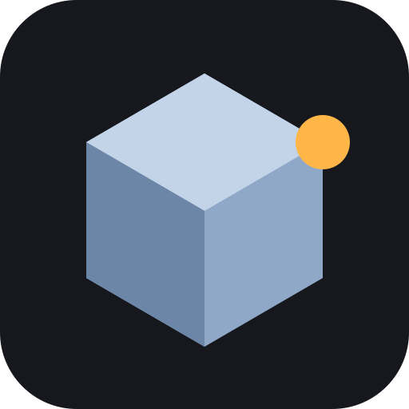
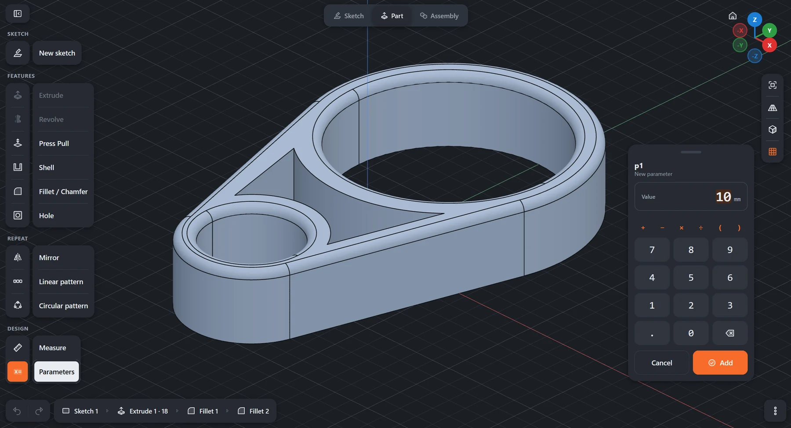

<p align="center">
  
</p>

<h1 align="center">WaffleCAD</h1>

<p align="center">
  Parametric 3D CAD for tablets, made for fingers and styluses.<br>
  <a href="https://yighy.github.io/wafflecad/"><b>Open the app</b></a>
</p>

<p align="center">
  
</p>

## Features

- **Sketches** with constraints and dimensions (FreeCAD's solver): lines, rectangles, circles, arcs, splines,
  trim, fillet, mirror, model edges brought into the sketch, DXF and SVG import.
- **Solids** with OpenCascade: extrude, revolve, Press Pull, shell, fillet / chamfer, metric holes
  (counterbore, countersink), mirror and patterns. Every step stays editable in the timeline.
- **Parameters**: name a value (`wall = 2`) and use it in any dimension (`width - 2*wall`).
- **Exchange**: STEP for other CAD software, STL for slicers.
- **Installable** (PWA) and works offline once loaded. A keyboard and a mouse work but are never needed.

## Gestures

| Gesture | Action |
| --- | --- |
| One finger or the stylus | Draw, tap to select, drag to move |
| Two fingers | Move together to rotate, pinch to zoom and pan (in a sketch: pan and zoom) |
| Two-finger / three-finger tap | Undo / redo |
| Back gesture | Cancel, leave the sketch |

Start with **New sketch**, tap a plane, draw, then **Finish sketch** and **Extrude**. Values are typed on
the on-screen keypad, which accepts expressions like `20*2+3`.

## Development

```bash
npm install
npm run dev     # dev server, also on the local network
npm test        # core tests under Node (solver, profiles, solids, imports)
npm run build   # static site in dist/, deployed to GitHub Pages on every push to main
```

Built with TypeScript, Vite and three.js. Sketches are solved by
[planegcs](https://github.com/Salusoft89/planegcs) on the UI thread; solids are built by OpenCascade through
[replicad](https://replicad.xyz) in a Web Worker. A document is a JSON list of features, saved in the
browser and replayed on every change (earlier steps are cached).

## Limitations

- One body per document; no assemblies yet.
- Faces and edges are found again by position: if an earlier change moves them a lot, the step needs
  to be picked again (it turns orange, or red, in the timeline).
- Model edges brought into a sketch, and sketches on faces, are copies: they do not follow later changes
  of the model.
